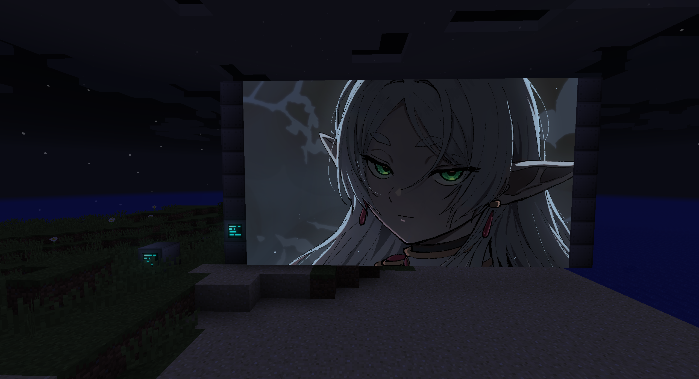
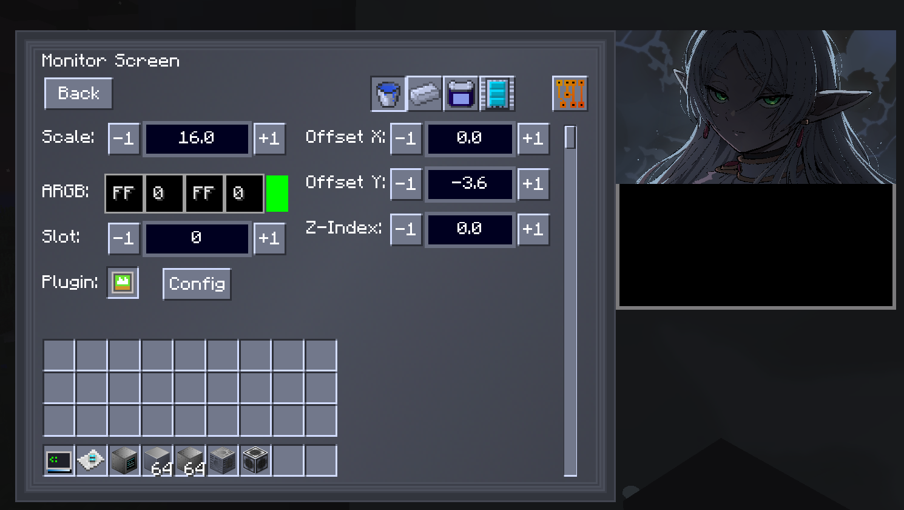

# ScuroGuardiano's GT Central Monitor improvements

I basically added offset x, offset y and z-index to settings. And also increased scale limit to 16,
so I can display my uwu frieren on the full screen.

## Z-Index doesn't work yet!

## AI disclaimer
Code was written by me but with help of Claude, which told me how to inject code, how to build stuff,
fix problems with Gradle etc.

Here is my full chat with Claude (it's in polish tho): https://claude.ai/share/415cd918-3547-4e87-9a88-d3e0039d0e60

## Credited Works
- [ZBGT](https://github.com/Zorbatron/ZBGT/issues) I used his project as a scaffold, it helped me a lot.

## PS
Java sucks, gimme Minecraft in C#.

Although spongepowered and mixinextras provide relatively easy way to inject code whenever I want.